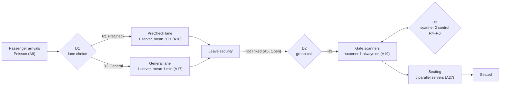

# Assumptions Document: Airport Passenger Simulation

**Version:** v0.1 (2026-11-18)
**Purpose:** This is the conceptual model. It is what the walk-through reviews, and it is the blueprint for the code. Every assumption has an ID. Code, tests and commits cite these IDs.

**ID scheme**

| Prefix | Meaning |
|---|---|
| **M** | Performance measure (what we report) |
| **A** | Modeling assumption |
| **D** | Decision point in the passenger flow |
| **R** | Routing / control rule at a decision point |
| **V** | Verification check (program vs. this document) |
| **Q** | Open question to settle before or during the walk-through |

**Status**

- **Fixed**: decided and in use.
- **Proposed**: a default we plan to use; it has not been confirmed yet.
- **Open**: still undecided. Must become Fixed or Proposed before the code that uses it is written.

Time is in minutes unless stated otherwise.

**Rule for changes:** Change this document first, then the code. A new or changed assumption gets a new or revised ID here before any code changes. The document version and the code tag must match (doc v0.3 = code v0.3).

---

## 1. Problem formulation

### 1.1 Questions the study answers (Proposed: confirm with team)

1. How long do passengers wait at the PreCheck and General security lanes for a single flight, and how long does the General lane take to clear?
2. Which way of handling the General-lane overload (A18) gives the best waits within the two-lane limit?
3. How long does boarding take, and how much does the on-demand second scanner (R4–R6) reduce it?
4. How does the seating capacity *c* (A27) affect the total boarding time?

### 1.2 Performance measures

| ID | Measure | Reported for | Status |
|---|---|---|---|
| M1 | Mean wait in queue (Wq), 95% CI | Each stage | Fixed |
| M2 | 95th-percentile wait | Each stage | Fixed |
| M3 | Queue length over time | Each stage | Fixed |
| M4 | Server utilization | Each server | Fixed |
| M5 | Time to clear (General lane; each boarding group; whole flight) | Stages 2–4 | Proposed |

### 1.3 Implementation (not a modeling assumption)

Python, with SimPy for the event logic, NumPy for random number generation and Matplotlib for plots.

---

## 2. Process flow

Stages: (1) PreCheck lane, (2) General lane, (3) boarding gate, (4) seating. Security (Stages 1–2) and boarding (Stages 3–4) are currently run as separate experiments (A5).

---

## 3. Assumptions

Sources: "Team choice" means a team decision that is not based on data. "Assumed" means a numeric value that has not been fitted to any data. Replace either with the real source (a project handout, published TSA or airline data, an observation) when there is one.

### 3.1 Scope

| ID | Assumption | Status | Source |
|---|---|---|---|
| A1 | Four stages are modeled: (1) TSA PreCheck lane, (2) General security lane, (3) boarding gate, (4) airplane seating. | Fixed | Team choice |
| A2 | Ours is the only flight. Security and the gate serve only our flight's passengers, so the results do not capture congestion at a busy airport. | Fixed | Team choice |
| A3 | There are exactly two security lanes, PreCheck and General, with 1 server each. | Fixed | Team choice |
| A4 | Check-in, immigration, walking, aircraft ground operations and disruptions are out of scope for the first build. | Proposed | Team choice |
| A5 | Security and boarding run as separate experiments: security exit times do not feed the gate. | Open | Team choice (see Q1) |
| A6 | Screening is one service step. There is no PreCheck eligibility check and no secondary screening (for example a bag re-check). | Fixed | Team choice |

### 3.2 Passengers

| ID | Assumption | Status | Source |
|---|---|---|---|
| A7 | 150 passengers per flight: 30 PreCheck (20%) and 120 General. | Open | Assumed (see Q2) |
| A8 | Each passenger has exactly 1 bag, so security screening and overhead-bin stowage are alike from one passenger to the next. | Fixed | Team choice |
| A9 | Arrivals at security form a Poisson process (exponential interarrival times): PreCheck λ = 0.5/min, General λ = 2/min, total 2.5/min. If rates vary over time, a non-homogeneous Poisson process is used. | Fixed | Assumed (see Q3) |
| A10 | Passengers are alike apart from PreCheck status. There are no small children (no family pre-boarding, no extra time at security or seating) and no mobility assistance. | Fixed | Team choice |

### 3.3 Global stochastic and queue behavior

| ID | Assumption | Status | Source |
|---|---|---|---|
| A11 | Service times are lognormal, with the mean set per stage and a coefficient of variation (CV) of 0.4 to 0.6. The baseline CV is 0.5. | Proposed | Assumed, not fitted to data |
| A12 | Service rates are stationary: each server's mean rate stays the same for the whole run, with no fatigue, breaks or staffing changes. Individual service times are still random. | Fixed | Team choice |
| A13 | Every stage is strictly first come, first served (FCFS). No one skips ahead. | Fixed | Team choice |
| A14 | Queues have unlimited capacity. Passengers do not balk (refuse to join), renege (leave the line) or switch lanes. | Proposed | Team choice (conflicts with Option D of A18) |
| A15 | Interarrival and service times are independent and identically distributed (i.i.d.). Each stage's draws are independent of the other stages. | Fixed | Team choice |

### 3.4 Stage 1: TSA PreCheck lane

| ID | Assumption | Status | Source |
|---|---|---|---|
| A16 | PreCheck service has a mean of 30 s (μ = 2/min). With λ = 0.5/min (A9), ρ = 0.25, so the lane is stable. | Fixed | Assumed |

### 3.5 Stage 2: General security lane

| ID | Assumption | Status | Source |
|---|---|---|---|
| A17 | General service has a mean of 1 min (μ = 1/min). With λ = 2/min (A9), ρ = 2, so the lane is overloaded and is analyzed as a transient (time-dependent) system. | Fixed | Assumed |
| A18 | How the overload is handled: one of Options A–D below. | Open | Team choice (see Q4) |

With ρ = 2 there is no steady state. The queue grows by about λ − μ = 1 person per minute, so E[N(t)] ≈ t, and a passenger who arrives at time t waits about t minutes. Because the population is finite (A7), 120 General passengers arriving at 2/min stop arriving at about 60 min. By then about 60 people are still waiting, the last arrival waits about 60 min, and the lane clears at about 120 min. The finite population therefore acts like Option A on its own, but the chosen option still decides how long passengers wait.

| Option | Description | Effect on other IDs |
|---|---|---|
| A. Peak window | λ = 2/min for a finite peak (for example 30 min), then a lower rate (for example 0.6/min). Report the peak queue and the time to clear. | Revises A9 (NHPP) |
| B. Overflow to PreCheck | The PreCheck server takes a General passenger whenever the PreCheck queue is empty. The combined utilization is 2.5/3 ≈ 0.83. | Adds rule R7; Stage 1 must then be verified with pooling off (V1) |
| C. Lower demand | λ < 1/min, for example 0.8, which gives Wq = 4 min under M/M/1. | Revises A9 |
| D. Balking | Arriving passengers refuse to join when the queue exceeds a threshold. | Revises A14; adds rule R8 |

### 3.6 Stage 3: Boarding gate

| ID | Assumption | Status | Source |
|---|---|---|---|
| A19 | There are 2 scanners. Scanner 1 is always on; scanner 2 switches on and off with the line length (R4–R6). | Fixed | Team choice |
| A20 | Groups hold min(30, remaining) passengers, so 150 passengers make 5 groups. When a group is called, everyone in it joins the line at the same moment. | Fixed (cap); Open (count, from A7) | Team choice |
| A21 | The next group cannot line up until the previous group's line has fully cleared. | Fixed | Team choice |
| A22 | Scanner 2 switches on when 15 or more passengers are in the gate system. | Proposed | Team choice |
| A23 | Scanner 2 switches off when the count falls to 14. An alternative is to wait until it falls to 10, so the scanner doesn't keep switching on and off. | Open | Team choice (see Q5, Q6) |
| A24 | Scan time has a mean of 6 s (μ = 10/min per scanner) and is lognormal with CV 0.5. | Open | Assumed |
| A25 | The gap between groups (the call plus the walk-up) is lognormal with a mean of about 60 s. | Open | Assumed |
| A26 | Every called passenger is present at the gate. There are no late arrivals and no no-shows. | Fixed | Team choice |

### 3.7 Stage 4: Airplane seating

| ID | Assumption | Status | Source |
|---|---|---|---|
| A27 | Seating is a service stage after the ticket scan. A passenger holds one of *c* parallel seating servers while walking down the aisle, stowing a bag and sitting down. Passengers enter the seating queue in FCFS order (A13). | Fixed (*c* Open) | Team choice |
| A28 | Seating time is lognormal, with the mean and CV not yet set. Because everyone has 1 bag (A8), every passenger draws from the same distribution. | Open | Assumed |
| A29 | Aisle blocking is represented only through *c*. There is no explicit row or seat geometry. | Proposed | Team choice |

### 3.8 Experiment design

| ID | Assumption | Status | Source |
|---|---|---|---|
| A30 | Each random process (arrivals per lane, service per stage, scans, gaps, seating) draws from its own named, seeded stream, so scenarios can be compared with common random numbers. | Fixed | Team choice |
| A31 | 30 to 100 or more independent replications. Report the mean with a 95% t-based confidence interval. | Open (count) | Team choice (see Q10) |
| A32 | Flight runs are terminating: they start empty and have no warm-up. A warm-up, chosen with Welch's method, is removed only in the open-ended Stage 1 validation run (V1), which reaches steady state. | Proposed | Team choice (see Q7) |

---

## 4. Decision points and rules

Rules are checked in the order listed. At each decision point they must be mutually exclusive and exhaustive: every passenger state and system state leads to exactly one action. In code, each rule is one branch marked `# R1`, `# R2`, and so on, with one test at its boundary.

| Rule | Decision point | Condition | Action | IDs | Status |
|---|---|---|---|---|---|
| R1 | D1 arrival at security | Passenger is PreCheck | Join the PreCheck queue | A3, A7 | Fixed |
| R2 | D1 arrival at security | Otherwise (General) | Join the General queue | A3, A7 | Fixed |
| R3 | D2 group call | Previous group's line is empty (or this is the first group) | After the gap (A25), release the next min(30, remaining) passengers into the gate line at once | A20, A21, A25 | Fixed |
| R4 | D3 scanner 2 control (checked on every gate arrival and departure) | Scanner 2 off and N ≥ 15 in the gate system | Turn scanner 2 on | A22 | Proposed |
| R5 | D3 scanner 2 control | Scanner 2 on and N ≤ off threshold (14, or 10) | Turn scanner 2 off (see Q6 for what happens to a scan in progress) | A23 | Open |
| R6 | D3 scanner 2 control | Otherwise | No change | A22, A23 | Proposed |

**Candidate rules: these apply only if the matching A18 option is chosen.**

| Rule | Decision point | Condition | Action | IDs |
|---|---|---|---|---|
| R7 | PreCheck server becomes free | PreCheck queue empty and General queue not empty | Serve the next General passenger | A18 Option B |
| R8 | D1, General passenger | General queue ≥ balk threshold | Leave without joining | A18 Option D, A14 |

There is no decision after the scan: every scanned passenger joins the seating queue (A27).

---

## 5. Input modeling

| Random variable | ID | Distribution | Parameters | Source | Data that would confirm it |
|---|---|---|---|---|---|
| PreCheck interarrival | A9 | Exponential | mean 2 min | Assumed | Lane entry timestamps |
| General interarrival | A9 | Exponential | mean 0.5 min | Assumed | Lane entry timestamps; check whether the rate changes over time (NHPP) |
| PreCheck service | A11, A16 | Lognormal | mean 0.5 min, CV 0.5 | Assumed | Time study of screening |
| General service | A11, A17 | Lognormal | mean 1 min, CV 0.5 | Assumed | Time study of screening |
| Gate scan | A24 | Lognormal | mean 0.1 min, CV 0.5 | Assumed | Scan log timestamps |
| Gap between groups | A25 | Lognormal | mean about 1 min, CV TBD | Assumed | Gate observation |
| Seating time | A28 | Lognormal | TBD | Assumed | Observation of the jet bridge to seat |

In validation mode, every service time is exponential with the same mean, so results can be compared with theory (V1, V3).

If data becomes available, follow the steps in Slideset 12, Part 4. Look at the data (histogram, lag correlation). Fit candidate families by maximum likelihood. Judge the fit with graphs first (Q–Q, density over histogram), then with K–S or χ². Compare upper quantiles, not just means. Keep validation data separate from the data used for fitting.

---

## 6. Analytic benchmarks

### 6.1 Stage 1 as M/M/1 (λ = 0.5, μ = 2, ρ = 0.25)

| Quantity | Formula | Value |
|---|---|---|
| Steady-state distribution | πₙ = (1 − ρ)ρⁿ | 0.75 · 0.25ⁿ |
| Lq | ρ² / (1 − ρ) | 0.083 |
| L | ρ / (1 − ρ) | 0.333 |
| Wq | Lq / λ | 0.167 min (10 s) |
| W | 1 / (μ − λ) | 0.667 min (40 s) |
| P(Wq > t) | ρ e^{−(μ−λ)t} | 0.25 e^{−1.5t} |
| 95th-percentile wait | ln(ρ / 0.05) / (μ − λ) | 1.07 min |

**Lognormal service, CV = 0.5 (M/G/1, Pollaczek–Khinchine):** Wq = Wq(M/M/1) × (1 + CV²)/2 = 10 s × 0.625 ≈ 6.25 s.

### 6.2 Reference values for Stage 2 (outside the two-lane constraint; for comparison only)

| Configuration | Wq |
|---|---|
| 1 lane, λ = 0.8 (Option C) | 4 min |
| 3 lanes (M/M/3), λ = 2 | ≈ 27 s |
| 4 lanes (M/M/4), λ = 2 | ≈ 5 s |

### 6.3 Stage 3: one group as a pure-death chain (exponential scans, off threshold 14)

Passengers leave at rate 2μ while N ≥ 15 and at rate μ for the last 14. This assumes scanner 2 stops instantly at N = 14 (see Q6).

| Quantity | Formula (m ≥ 15) | m = 30 |
|---|---|---|
| Mean time to clear the group | (m − 14)/(2μ) + 14/μ | 22/μ |
| Variance of clear time | (m − 14)/(4μ²) + 14/μ² | 18/μ² (sd ≈ 4.24/μ) |
| Mean time in system | — | 9.5/μ |
| Mean wait before scan | — | 8.5/μ |

For m < 15, the mean clear time is m/μ.

| μ per scanner | Clear time (m = 30) |
|---|---|
| 6/min | 220 s |
| 8/min | 165 s |
| 10/min | 132 s (sd 25 s, mean wait 51 s) |
| 12/min | 110 s |
| 10/min, one scanner only | 180 s |

For the whole flight, total boarding time ≈ Σ(group clear times) + Σ(gaps). Because the groups are independent, the variances add.

---

## 7. Verification plan (does the program match this document?)

| ID | Check | Configuration | Pass criterion | IDs covered |
|---|---|---|---|---|
| V1 | Known answer: Stage 1 as M/M/1 | Exponential service, long open-ended arrival stream, R7 off, warm-up removed (A32) | 95% CIs for Lq, Wq, W, utilization and the 95th-percentile wait cover the values in §6.1 | A9, A13, A16, A30–A32 |
| V2 | Known answer: Stage 1 as M/G/1 | As V1, with lognormal CV 0.5 | CI for Wq covers ≈ 6.25 s | A11, A16 |
| V3 | Known answer: one boarding group | Exponential scans, m = 30, μ = 10 | Mean and sd of the clear time match §6.3 (132 s, 25 s) | A19–A23, R4–R6 |
| V4 | Flow conservation | Every run | Arrivals = completions + passengers still in the system, exactly | All stages |
| V5 | Little's law | Steady-state runs (V1) | L = λW within sampling error (0.333 = 0.5 × 0.667) | A16 |
| V6 | Input moments | Sample 10,000 draws from each stream | Sample mean and CV match the table in §5 | A11, A24, A25, A28 |
| V7 | Rule tests | Hand-built states | One test per rule at its boundary (for example R4 with N = 14 vs. 15) | R1–R6 |
| V8 | Transient sanity check: Stage 2 | 120 General passengers, λ = 2, exponential service | Last arrival near 60 min; queue near 60 at that time; clears near 120 min | A7, A17 |

Results from Stage 2, Stage 4 and the lognormal scenarios are trusted only after V1–V3 pass.

## 8. Validation plan (is this the right model?)

- **Walk-through:** review §3 and §4 with the team (and the instructor, if available) before coding. Settle every Q in §10.
- **Face validity:** check that waits, clear times and boarding duration look plausible against published airport and airline figures.
- **Sensitivity analysis:** vary the CV (A11), the scanner thresholds (A22, A23), the scan rate (A24) and *c* (A27) to find which assumptions most need data.
- **Results validation:** no real system data is available yet. If any is obtained, keep it separate from data used to fit inputs.

---

## 9. Traceability (planned; fill in as code is written)

| ID(s) | Code location | Test |
|---|---|---|
| A9 | `config.py`: `precheck_arrival_rate`, `general_arrival_rate` | V6 |
| A11, A16, A17 | `config.py`: `precheck_service`, `general_service` | V6, V1, V2 |
| R1, R2 | `routing.py`: `choose_lane` | V7 `test_lane_by_passenger_type` |
| R3, A21 | `routing.py`: `release_next_group` | V7 `test_group_waits_for_clear_line` |
| R4–R6, A22, A23 | `routing.py`: `scanner2_control` | V7 `test_scanner2_on_at_15`, `test_scanner2_off_at_threshold`; V3 |
| A27, A28 | `config.py`: `seating_servers`, `seating_service` | V6 |
| A30 | `inputs.py`: named streams | `test_same_seed_same_output` |
| A31, A32 | `experiment.py` | V1 |

---

## 10. Open questions

| ID | Question | Affects |
|---|---|---|
| Q1 | Should security exit times feed the gate, or do security and boarding stay separate experiments? | A5 |
| Q2 | Confirm 150 passengers and the 20% PreCheck share. | A7, A20 |
| Q3 | Arrivals are Poisson (A9), but the count per flight is fixed (A7). Pick one: generate Poisson arrivals until the fixed count is reached (the arrival window then varies), or fix the count and spread arrivals uniformly over a set window (Poisson conditioned on the count). | A7, A9 |
| Q4 | Which overload option (A–D)? Option D contradicts A14, and Option B adds R7 and changes how V1 is run. | A14, A18 |
| Q5 | Is the off threshold 14 or 10? With 10, R6 ("no change") applies for N = 11–14. | A23, R5, R6 |
| Q6 | When scanner 2 switches off, does it finish the scan in progress? The §6.3 benchmark assumes it stops instantly. | A23, R5, V3 |
| Q7 | Confirm that warm-up applies only to the V1 validation run, since flight runs are terminating. | A32 |
| Q8 | How are passengers assigned to boarding groups, and does PreCheck status matter? (This only matters if Q1 links the stages.) | A20 |
| Q9 | Set the values for scan time, gap, seating time and *c*. | A24, A25, A27, A28 |
| Q10 | Set the replication count from a target CI half-width (for example ±5% of the mean). | A31 |
| Q11 | When both scanners are idle, which one takes the next passenger? This affects only per-scanner utilization (M4). | A19 |

---

## 11. Build plan (iterative versions)

Each version runs end to end, passes all earlier checks, and is shown before the next one starts.

| Version | Adds | IDs | Verified by |
|---|---|---|---|
| v0.1 | Skeleton: arrivals, both lanes, gate, seating, statistics, runner; exponential times | A1–A3, A9, A13, A30 | V1, V4, V5 |
| v0.2 | Finite flight population; Stage 2 transient behavior | A7, A17 | V8 |
| v0.3 | Boarding groups and on-demand scanner 2 | A19–A23, R3–R6 | V3, V7 |
| v0.4 | Lognormal service and scan times | A11, A24, A25, A28 | V2, V6 |
| v0.5 | Overload policy chosen in A18 | A18 (+ R7 or R8) | V7 |
| v1.0 | Production runs: replications, CIs, scenarios | A31, A32 | All |

---

## 12. Known limitations

- Exponential service is used only for validation. The lognormal CV is assumed, not fitted to data (A11).
- Staffing changes, server breaks and fatigue are not modeled (A12).
- There is no lane switching, eligibility checking or secondary screening (A6, A14).
- Every called passenger is present at the gate (A26).
- Passengers are alike apart from PreCheck status (A8, A10).
- There are no other flights, so the results do not capture airport-wide congestion (A2).
- Aisle interference is represented only through *c* (A29).

---

## 13. Change log

| Version | Date | Changes |
|---|---|---|
| v0.1 | 2026-11-18 | Restructured into the Slideset 12 format: added IDs (M, A, D, R, V, Q), sources, a rule table, a traceability map, verification and validation plans, a build plan and open questions. No assumption values or statuses were changed. Added the open questions Q3, Q5, Q6 and Q7, which came from inconsistencies found during the restructuring. |
